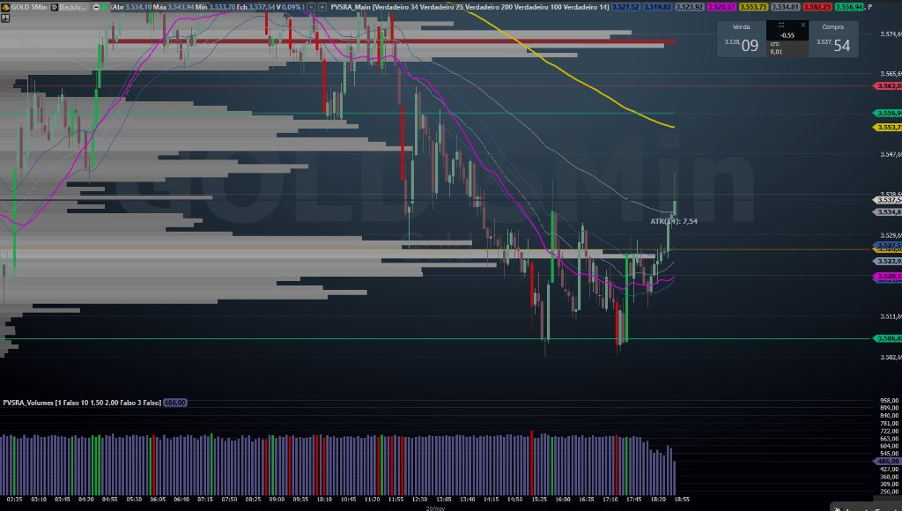

# Sunrise PVSRA Suite — BlackArrow (NTSL)

Suíte completa de **PVSRA (Price, Volume, Support & Resistance Analysis)** + **Auction Market (VAH / VAL / POC dinâmicos + ATR)** desenvolvida e adaptada em **NTSL** para a plataforma **Nelogica BlackArrow**.



---

## Conteúdo do Repositório

```text
├── assets/
│   └── preview.jpg                        # Captura real do template na BlackArrow Ultra
├── presets/
│   ├── Sunrise_PVSRA_Indicators.psf       # Pacote pronto com todos os indicadores e códigos-fonte
│   └── Sunrise_PVSRA_Layout.prt           # Layout completo do gráfico (cores, estudos e Volume Profile)
└── scripts/
    ├── PVSRA_Main.ntsl                    # Dragon (EMA 34), VWMA 25, EMA 200, EMA 100 e ADR (14d)
    ├── Sunrise_Price_Auction.ntsl         # VAH, VAL e POC dinâmicos por Timeframe + valor ATR(14)
    ├── PVSRA_Candles_Coloracao.ntsl       # Regra de coloração PVSRA para os candles (Clímax e Rising)
    ├── PVSRA_Volumes.ntsl                 # Histograma de volume PVSRA em subjanela
    └── PVSRA_Force_Numbers.ntsl           # Níveis psicológicos/institucionais (000 / 250 / 500 / 750)
```

---

## Explicação de Cada Indicador

### 1. `PVSRA_Main` *(Sobre o gráfico de preços)*
Reúne as médias estruturais de tendência e canal no gráfico principal:
* **Dragon (EMA 34 High / Low / Close):** canal de tendência de curto/médio prazo em azul suave com linha central tracejada. *(Na aba **Preenchimento** das Propriedades do indicador, você pode ativar o preenchimento translúcido entre Plot 1 e Plot 2.)*
* **VWMA 25 (Magenta Contínua):** média móvel ponderada pelo volume de 25 períodos, acompanhando o fluxo recente de preço e volume.
* **EMA 200 (Amarela Tracejada Grossa):** referência de tendência macro principal.
* **EMA 100 (Branca Tracejada):** referência intermediária *(pode ser ocultada via `MostrarEMA100 = Falso`)*.
* **MTF ADR Projection (14 dias):** projeção de máxima e mínima diária pelo Average Daily Range dos últimos 14 pregões *(pode ser ocultada via `MostrarADR = Falso` caso queira usar apenas VAH/VAL)*.

---

### 2. `Sunrise_Price_Auction` *(Sobre o gráfico de preços)*
**Autor:** `Sunrise (elementaldocaos)`

Indicador autoral criado para leitura de **Teoria de Leilão (Auction Market Theory)** e **volatilidade** sem poluir o gráfico nem ocupar subjanela:
* **VAH (Value Area High — Rosa/Vermelho), VAL (Value Area Low — Verde Menta) e POC (Dourado):** calcula o Volume Profile de **70% da Área de Valor** sobre os últimos `PeriodoVP` candles (padrão `120`) **do Timeframe aberto no gráfico**.
* **Linhas Retas Dinâmicas por TF:** traça linhas horizontais retas que se atualizam automaticamente conforme o candle atual se forma e recalculam ao trocar de timeframe (`1Min`, `5Min`, `15Min`, `60Min`, `1D`, etc.).
* **Valor do ATR(14) Wilder no gráfico:** exibe `ATR(14): valor` diretamente próximo ao candle atual via `PlotText`, mantendo 100% da área vertical do gráfico livre.

**Parâmetros principais:**
| Parâmetro | Padrão | Descrição |
| :--- | :--- | :--- |
| `PeriodoVP` | `120` | Janela de candles do timeframe atual usada para VAH/VAL/POC |
| `NumFaixas` | `40` | Resolução vertical do perfil de volume (`10` a `50` faixas) |
| `PercentualVA` | `70.0` | Porcentagem da Área de Valor |
| `FonteVolume` | `1` | `1 = Quantity` (Qtd/Lotes) · `2 = Trades` (Tick Volume) · `3 = Volume` Financeiro |
| `MostrarPOC` | `true` | Exibe/oculta a linha horizontal da POC |
| `MostrarATR` | `true` | Exibe/oculta o texto `ATR(14)` no último candle |
| `CasasDecimais` | `2` | `2` para Ouro/Índices/BTC · `5` para Forex (`EURUSD`) · `3` para pares `JPY` |

---

### 3. `PVSRA_Coloracao` *(Regra de Coloração nos candles)*
Pinta os candles do gráfico de acordo com a atividade de volume comparada à média dos **10 candles anteriores**:
* **Clímax — Verde (alta) / Vermelho (baixa):**
  * Volume ≥ `200%` da média dos últimos 10 candles, **OU**
  * Produto `Volume × (High - Low)` ≥ maior produto dos últimos 10 candles.
* **Rising (Volume em Ascensão) — Azul (alta) / Violeta (baixa):**
  * Volume ≥ `150%` da média dos últimos 10 candles.
* **Normal — Cinza claro (alta) / Cinza escuro (baixa):** demais candles.

---

### 4. `PVSRA_Volumes` *(Subjanela / Nova Janela)*
Histograma de volume sincronizado com as mesmas regras e cores dos candles (`Clímax`, `Rising` e `Normal`), com:
* `MostrarMedia` (`false` padrão): opcional para plotar a linha da média móvel de 10 períodos sobre o histograma.
* `AlertaClimax` (`false` padrão): opcional para disparar alerta na barra atual quando houver volume de Clímax.
* `FonteVolume` (`1` padrão): deve usar a mesma fonte configurada no `PVSRA_Coloracao` para manter cores sincronizadas.

---

### 5. `PVSRA_Force_Numbers` *(Sobre o gráfico — opcional)*
Traça linhas horizontais nos níveis institucionais de quartos (`000`, `250`, `500`, `750`).

**Ajuste recomendado de `PassoInteiro` por ativo:**
* **Forex 5 dígitos (`EURUSD`, `GBPUSD`, `AUDUSD`):** `0.0100` *(quartos a cada 25 pips)*
* **Pares `JPY` (`USDJPY`, `EURJPY`):** `1.000`
* **Ouro (`XAUUSD` / `GOLD`):** `10.0` ou `25.0`
* **Índices / Cripto (`NAS100`, `US30`, `BTCUSD`):** `100.0` ou `1000.0`

---

## Instalação Rápida (Recomendado — 2 Cliques)

Esta é a forma mais rápida: importa **todos os indicadores, cores, Volume Profile nativo e layout** de uma vez só.

> **Ordem obrigatória:** importe **primeiro o `.psf`** e **depois o `.prt`**, para o layout já encontrar todos os indicadores instalados.

1. Baixe os arquivos da pasta [`presets/`](presets):
   * [`Sunrise_PVSRA_Indicators.psf`](presets/Sunrise_PVSRA_Indicators.psf)
   * [`Sunrise_PVSRA_Layout.prt`](presets/Sunrise_PVSRA_Layout.prt)
2. Na **BlackArrow**, vá em **Estratégias → Importar/Exportar → Importar**:
   * Selecione `Sunrise_PVSRA_Indicators.psf` e importe todas as estratégias (`PVSRA_Main`, `PVSRA_Coloracao`, `PVSRA_Volumes`, `Sunrise_Price_Auction`, `PVSRA_Force_Numbers`).
3. Em seguida, acesse o menu **Arquivo (ou Menu Principal) → Importar/Exportar Configurações → Importar**:
   * Selecione `Sunrise_PVSRA_Layout.prt`.
   * Na opção de mesclagem, escolha **Adicionar** *(para não sobrescrever os layouts que você já usa)*.
   * Conclua e selecione o layout importado no seu gráfico.

*(Nota: o arquivo `.prt` foi gerado na **BlackArrow Ultra** e é compatível apenas com a plataforma BlackArrow.)*

---

## Instalação Manual (Via Código-Fonte `.ntsl`)

Caso prefira criar e editar manualmente no **Editor de Estratégias**:

1. Abra **Estratégias → Editor de Estratégias → Em Branco**.
2. Crie cada estratégia colando o conteúdo dos arquivos da pasta [`scripts/`](scripts) e salvando (`Ctrl + S`) com o nome correspondente:
   * `PVSRA_Main` ← [`PVSRA_Main.ntsl`](scripts/PVSRA_Main.ntsl)
   * `Sunrise_Price_Auction` ← [`Sunrise_Price_Auction.ntsl`](scripts/Sunrise_Price_Auction.ntsl)
   * `PVSRA_Coloracao` ← [`PVSRA_Candles_Coloracao.ntsl`](scripts/PVSRA_Candles_Coloracao.ntsl)
   * `PVSRA_Volumes` ← [`PVSRA_Volumes.ntsl`](scripts/PVSRA_Volumes.ntsl)
   * `PVSRA_Force_Numbers` ← [`PVSRA_Force_Numbers.ntsl`](scripts/PVSRA_Force_Numbers.ntsl) *(opcional)*
3. No gráfico do ativo:
   * **Botão direito no gráfico → Inserir Indicador:** adicione `PVSRA_Main` e `Sunrise_Price_Auction` sobre o gráfico.
   * **Botão direito no gráfico → Inserir Indicador → Inserir em Nova Janela:** adicione `PVSRA_Volumes`.
   * **Botão direito sobre um candle → Inserir Regra de Coloração:** adicione `PVSRA_Coloracao` **somente no ativo/candles** *(não aplique sobre o `PVSRA_Main`, senão as linhas das médias ficam pintadas com a cor dos candles)*.
   * *(Opcional)* **Exibir / Inserir Indicador → Volume Profile** (nativo da BlackArrow) para o histograma lateral.

---

## Dicas de Configuração por Ativo

* **Volume em CFDs / Forex:** se o histograma ficar muito uniforme com `FonteVolume = 1` (`Quantity`), teste alterar `FonteVolume` para **`2` (`Trades`)** ou **`3` (`Volume`)** tanto no `PVSRA_Volumes` quanto no `PVSRA_Coloracao` e no `Sunrise_Price_Auction`.
* **Casas decimais do ATR:** em `Sunrise_Price_Auction`, ajuste `CasasDecimais` para `5` em pares Forex (ex.: `EURUSD`) ou `3` em pares `JPY`.

---

## Créditos e Licença

* **Sunrise (`@elementaldocaos`):** Idealização e desenvolvimento do `Sunrise_Price_Auction` (VAH/VAL/POC dinâmicos por TF + leitura ATR), adaptação completa da suíte para NTSL/BlackArrow, integração da `VWMA 25` e preset completo.
* **Base PVSRA original (MT5):** [japarico/MT5-Trading-Related-Japa-Rico](https://github.com/japarico/MT5-Trading-Related-Japa-Rico) · Fernando H Rosa · Traderathome · Fisher755.
* **Licença:** Uso e distribuição **100% gratuitos** para a comunidade. **Comercialização estritamente proibida** (não vender, alugar ou empacotar para fins comerciais).
